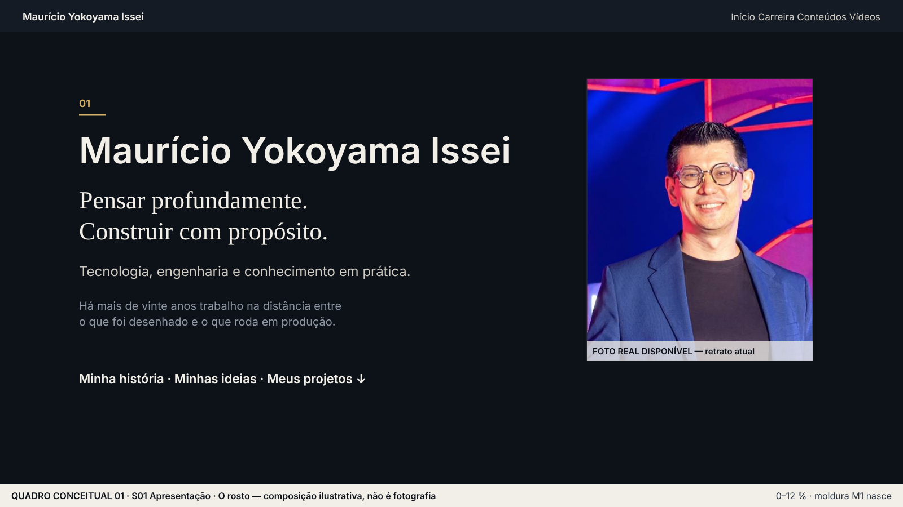
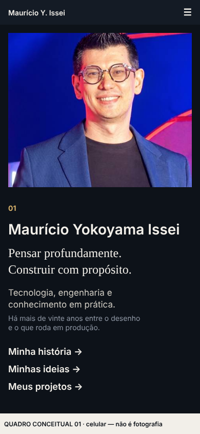
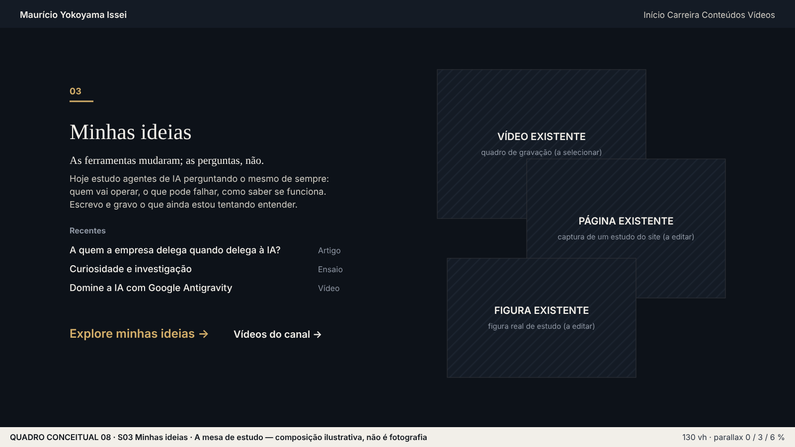

# Storyboard da nova home — "O pensamento em prática"

> Os quadros deste documento são **conceituais**: desenhos de composição com
> caixas hachuradas no lugar das fotos que ainda não existem. A única
> fotografia que aparece é o **retrato real** do Issei, já publicado no site
> (inteiro no quadro 01 e no 07, recortado nos olhos no 06), e ela está
> marcada como tal. Nenhum quadro é fotografia real de uma cena.
> As imagens ficam em `quadros/` (PNG para ver, SVG para editar).
>
> Legenda de origem usada em todo o documento:
> **[D]** disponível · **[E]** existente, precisa ser selecionado ou editado ·
> **[P]** precisa ser produzido · **[C]** referência conceitual, sem recurso ainda.

---

## 1. Conceito e intenção narrativa

**O pensamento em prática.** O filme mostra uma pessoa que pensa antes de
fazer e continua pensando enquanto faz. A câmera não descreve um currículo;
ela acompanha um dia de trabalho de hoje, que é digital: uma pergunta que se
desmonta em partes, as fontes que se fecham para explicar, o diagrama, o
teclado, o teste e a operação à noite.

A intenção é que o visitante saia com três ideias:

1. **Quem:** Maurício Yokoyama Issei, rosto real, primeira imagem.
2. **Como trabalha:** as dimensões não são uma lista. Uma leva à outra.
   A pergunta se desmonta em partes; cada parte pede estudo; fechar as fontes
   e explicar mostra o que foi aprendido; o desenho existe para outra pessoa
   operar; o teste diz se está certo; na crise, a causa raiz vira a próxima
   pergunta. E o que ele consegue explicar, publica.
3. **O que encontra aqui:** três caminhos, que são três faces da mesma
   pessoa: a trajetória (Minha história), o que pensa e publica (Minhas
   ideias) e o que construiu (Meus projetos).
4. **Por que isso importa hoje:** quem estuda agentes de IA agora traz vinte
   anos de engenharia, arquitetura e operação. As ferramentas mudaram; as
   perguntas, não. A ponte é dita uma vez, na cena 08.

O filme **começa e termina no rosto**: abre no retrato e fecha a abertura no
mesmo rosto, que volta pelos olhos. Isso fecha o ciclo "perguntar → … →
ensinar" sem precisar dizer. Do rosto, a moldura passa direto para o retrato
da história (cena 07), sem tela de menu no meio.

**Uma voz só.** Toda a narração, da cena 01 à 09, usa a mesma voz: primeira
pessoa, frase curta, com o atrito real do trabalho. Os textos de apoio das
sessões 02–04 seguem essa voz e não usam palavras de portfólio
("resultados", "soluções", "experiências").

## 2. Sinopse da experiência

A página abre no retrato, com nome, mensagem e os três caminhos já visíveis.
Quem não quiser rolar já sabe quem é e para onde ir.

Ao rolar, o retrato some e a moldura recebe uma pergunta real, digitada: "Este
agente pode executar sozinho?". A pergunta se desmonta em três partes, cada
uma com as suas fontes. Depois a moldura fecha até virar o traço dourado: as
fontes fecharam, e ele tenta explicar. A moldura reabre num diagrama real, e
sobre ele entram o teclado e o teste. Um corte seco leva à noite: um monitor de
operação, o traço lateral racha, e a pergunta "Por que falhou?" é digitada. O
traço se repara: a causa vira a próxima pergunta. Por fim, o rosto volta pelos
olhos e a câmera recua até o retrato.

Do rosto, a moldura recua e volta a ser o retrato, agora ao lado
de cinco marcos da trajetória, de 1997 até hoje (Minha história). O retrato recua e, por trás
dele, deslizam três registros reais de estudo e publicação (Minhas ideias).
Esses registros se alinham e se dividem em quatro capturas de projetos reais
(Meus projetos). O traço dourado que acompanhou toda a página termina como
sublinhado do último link, e o rodapé de contato aparece sem tela de
encerramento.

**Duração:** cerca de 7 telas no computador (750 vh no teto, SDD §3.5) e 6 no
celular. Isso dá de 30 a 45 s numa rolagem contínua. Cada cena dura o tempo
de ler uma frase.

## 3. Direção visual e audiovisual

| Aspecto | Direção |
| :-- | :-- |
| Base | Paleta **Aizome + Kin** (SDD §4.1): fundo índigo-carvão `#0D1219`, superfície `#141B25`, penumbra `#080C11` (só cena 05); tinta `#F2EFE9`, texto `#D0CCC3`, legenda `#8F97A4`; ouro fosco *Kintsugi* `#D4AF6A` em **um** elemento por quadro; divisórias de 1 px (*Shoji*). Cabeçalho e rodapé comuns, escuros, como no resto do site |
| Fotografia | Documental, luz natural lateral (janela), sem flash, sem fundo removido, sem filtro. Leve dessaturação (−10 %) na pós, igual em todas. 3:2 nas cenas, 4:5 no retrato |
| Pessoas | O Issei é o único rosto em primeiro plano. Outras pessoas aparecem de costas ou fora de foco, com autorização |
| Lente (equivalente 35 mm) | 35 mm nos planos de ambiente, 50 mm nos médios, 85 mm nos detalhes (mãos, teclado). Sem grande-angular extrema |
| Câmera simulada | Gestos: cortina (revelação por máscara, inclusive ao centro), *pan* lateral (pelo enquadramento da foto), corte seco, digitação (texto real revelado por máscara) e um único recuo grande, dos olhos ao retrato (escala 2 → 1, cena 06). Escala ≤ 1,06 no resto. Nenhuma rotação |
| Tipografia | Nome em Inter 600; mensagem e títulos de sessão em serifada editorial (proposta: Shippori Mincho); texto em Inter 400 |
| Elemento recorrente | **A moldura (M1)**: o retângulo que viaja entre as cenas, com fio *Shoji*; na cena 03 ela fecha até virar o traço. **O traço dourado *Kintsugi***: linha vertical ao lado do texto na S01; racha e se repara na cena 05; vira linha vertical na S02 e sublinhado no fim |
| Som | **Nenhum.** A página não toca áudio. A "narração" é texto curto na tela, escrito em primeira pessoa. Se um dia houver versão em vídeo do mesmo roteiro (por exemplo, um teaser para o canal ou para redes), a narração serve como locução (ver §6). Essa versão pode ser feita sem custo no **HyperFrames** (HTML para vídeo, código aberto, local), reaproveitando as fotos reais, os textos e a paleta da página. A home em si não usa vídeo |
| Ritmo | Imagem longa, troca curta: a troca ocupa de 1,5 % a 3,5 % da faixa. Texto parado enquanto a imagem anda. A cena 02 é densa (digitação e partes); a cena 03 é silêncio; a 05 tem o único corte seco |

---

## 4. Storyboard sequencial

> As faixas (%) são da Sessão 01 (referência 300–360 vh, SDD §3.5). As demais sessões são medidas em vh.

### Cena 01 — O rosto

Versão celular: 

| Ficha | |
| :-- | :-- |
| **A. Identificação** | Sessão 01 · Apresentação · Objetivo: responder em 3 s quem é, o que faz e o que há no site |
| **B. Composição** | Retrato 4:5 à direita (colunas 8–11), olhando para a câmera, meio corpo. À esquerda, sobre o fundo índigo: número 01 com traço dourado, nome, mensagem, subtítulo, uma linha de contexto e os três caminhos. 45 % do quadro vazio (Ma). Luz frontal suave. Ponto de atenção: o rosto, depois o nome |
| **C. Direção** | Plano médio. Câmera parada. Sem movimento até a pessoa rolar. Duração: 0–10 % da faixa (~3 s) |
| **D. Texto na tela** | **Maurício Yokoyama Issei** / *Pensar profundamente. Construir com propósito.* / Tecnologia, engenharia e conhecimento em prática. / Há mais de vinte anos trabalho na distância entre o que foi desenhado e o que roda em produção. / Minha história · Minhas ideias · Meus projetos ↓ |
| **D. Relação** | A imagem diz "pessoa real"; a mensagem dá o tom; a linha de contexto nomeia o conflito do trabalho (desenho × produção), que as cenas 02–06 percorrem; os links dizem "o que há aqui". Nada depende de animação |
| **E. Transição** | Começa estática (é a primeira pintura). Ao rolar, o retrato reduz para 60 % e desliza para a direita, saindo do quadro; a moldura M1 fica no lugar e recebe a próxima foto. **Permanece:** M1, o número 01 e o nome (reduzido) |
| **F. Origem** | Retrato **[D]** (`retrato-original.jpg`, blazer azul) **já na H-1**: o fundo azul combina com o índigo da página; a moldura *Shoji* e o espaço vazio fazem a harmonia, sem recorte. Um retrato novo **[P]** é melhoria opcional |

### Cena 02 — A pergunta (pensar · investigar · estudar)

| Ficha | |
| :-- | :-- |
| **A** | Sessão 01 · Mostrar que o trabalho começa com uma pergunta, e que ele a desmonta antes de responder |
| **B** | Dentro de M1, sobre `--hm-aizome-2`, texto real: a pergunta "Este agente pode executar sozinho?" e, abaixo, três partes em colunas, cada uma com as suas fontes: "Quem vai operar?" (Runbook · Plantão), "O que pode falhar?" (Incidentes · Logs), "Como saber se funciona?" (Aceite · Métricas). Fundo da página em penumbra (`--hm-aizome-deep`). Ponto de atenção: a pergunta, depois as partes |
| **C** | Sem foto. M1 entra por cortina de baixo para cima (10–12,5 %); a pergunta é digitada (13–18 %); as partes descem uma a uma (19–25 %); as fontes aparecem (23–28 %) |
| **D** | *Quase tudo começa com uma pergunta.* Antes de responder, desmonto a pergunta e estudo cada parte. |
| **D. Relação** | A imagem mostra o gesto de decompor; o texto dá a ordem (perguntar, desmontar, estudar). As fontes nomeiam onde ele investiga, sem citar ferramenta |
| **E** | Começa com o retrato saindo e M1 entrando. Termina com M1 fechando ao centro (30–33,5 %). **Permanece:** M1, que fecha até virar o traço da cena 03 |
| **F** | **[D]** Só texto. As três partes voltam na ponte da cena 08 |

### Cena 03 — Fechar e explicar (aprender)

| Ficha | |
| :-- | :-- |
| **A** | Sessão 01 · Mostrar que aprender é explicar sem consultar (compor e verificar) |
| **B** | Nenhuma imagem. M1 fechou e virou um traço dourado horizontal, parado no meio do palco. O traço lateral some. Ponto de atenção: o traço |
| **C** | Cortina ao centro (30–33,5 %); o traço cresce da esquerda para a direita (31–33,5 %) e fica parado até 40 %. É o silêncio da página |
| **D** | *Então fecho as fontes e tento explicar.* É aí que descubro o que eu só reconhecia. |
| **D. Relação** | O vazio é a própria imagem: as fontes fecharam. O texto diz o que o vazio quer dizer |
| **E** | Começa com M1 fechando. Termina com o traço sumindo e M1 reabrindo do centro (41–44,5 %). **Permanece:** o lugar de M1 |
| **F** | **[D]** Nenhum recurso |

### Cena 04 — Do diagrama ao teste (projetar · construir · validar)

| Ficha | |
| :-- | :-- |
| **A** | Sessão 01 · Mostrar que o desenho existe para outra pessoa operar e que o teste decide |
| **B** | A: o diagrama real das cinco camadas da página Agent Ready (captura). B: mãos no teclado. C: duas telas de teste. B e C entram sobre o canto inferior direito de M1 e passam um pouco da moldura. Ponto de atenção: o diagrama, depois as mãos, depois o teste |
| **C** | M1 abre do centro (41–44,5 %); *pan* lento em A; B entra (48–51 %) e C entra no lugar de B (53–56 %), com deslize curto. No celular, B e C entram dentro de M1 por cortina lateral |
| **D** | *Desenho para que outra pessoa consiga operar.* Construo em passos pequenos, e o teste diz se está certo. |
| **D. Relação** | O diagrama é trabalho publicado, não ilustração. As fotos mostram mãos e telas, sem pose |
| **E** | Termina com corte seco para a noite (60 %). **Permanece:** M1 |
| **F** | A: **[E]** captura de `/agent-ready`. B e C: **[P]** fotos 4 e 6 |

### Cena 05 — A noite e a causa (sustentar · liderar · evoluir)

| Ficha | |
| :-- | :-- |
| **A** | Sessão 01 · Mostrar a crise: estabilizar com o time, achar a causa raiz e transformar a causa em pergunta nova |
| **B** | Monitor de operação numa sala em penumbra, só a luz da tela. Na base de M1, uma faixa de véu com "Por que falhou?" em texto real. O traço lateral racha no meio. Página em penumbra. Ponto de atenção: a luz da tela, depois a pergunta |
| **C** | Corte seco (60 %), o único do filme. A luz da tela sobe (61–68 %). O traço racha (61–63 %). "Por que falhou?" é digitado (72–75 %). A segunda frase entra (73–76 %). O traço se repara (76–80 %) |
| **D** | *Na crise, o tempo conta.* Com o time, primeiro estabilizo; depois vou até a causa raiz. *A causa vira a próxima pergunta.* |
| **D. Relação** | O traço que racha e se repara é o *Kintsugi* em movimento: a falha fica visível e vira parte da peça. "Por que falhou?" responde à pergunta da cena 02 e fecha o ciclo |
| **E** | Termina com a noite saindo e o rosto entrando (80–83 %). **Permanece:** M1 e o traço reparado |
| **F** | **[P]** Foto 7. Tela sem nome de empresa, sem dado legível. Plano B: a faixa "Por que falhou?" sobre `--hm-aizome-deep`, sem foto |

### Cena 06 — O rosto de novo (ensinar · compartilhar)

| Ficha | |
| :-- | :-- |
| **A** | Sessão 01 · Fechar o ciclo: quem perguntou é quem explica e publica; volta o rosto |
| **B** | O retrato da cena 01, primeiro recortado nos olhos, depois inteiro. Ponto de atenção: os olhos |
| **C** | Entra em escala 2 nos olhos e recua até 1 (83–97 %). É a única exceção ao limite de escala (SDD §5.1). No fim, M1 reduz para 0,88 e desliza para a esquerda (97–100 %) |
| **D** | *O que consigo explicar, eu publico.* Ensinar é como verifico se entendi de verdade. |
| **D. Relação** | "Consigo explicar" retoma a cena 03 (fechar as fontes e explicar); publicar é o mesmo teste, feito em público |
| **E** | Termina com M1 na direção do retrato da S02. **Permanece:** o rosto, que passa da cena 06 para o retrato da cena 07 |
| **F** | **[D]** Retrato atual (1600 × 2000 px). Um retrato novo **[P]** é melhoria opcional |

### Cena 07 — O retrato e o tempo (Minha história)

| Ficha | |
| :-- | :-- |
| **A** | Sessão 02 · Dar acesso à trajetória sem repetir o /curriculo |
| **B** | Retrato 4:5 à esquerda (5 colunas). À direita: número 02, o traço dourado agora vertical, título, texto de apoio, cinco marcos de ano no traço e o link. Ponto de atenção: o retrato, depois o link dourado |
| **C** | Plano médio. Parallax: a foto sobe 4 % mais devagar que a rolagem. Os cinco marcos aparecem um a um, de cima para baixo. 120 vh (~6 s) |
| **D** | **Minha história** / Comecei escrevendo código. Com o tempo, passei a responder também por times, contratos e sistemas em produção. / 1997 curso técnico em processamento de dados · 2003 Java na Sysgen · 2012 liderança de time na Indra · 2018 Tech Lead na Rede · 2024–hoje arquitetura, IA aplicada, engenharia de agentes e ensino / **Conheça minha história →** |
| **D. Relação** | Cinco marcos e nenhum resultado detalhado: a história completa (resultados, recomendações, certificações) fica no destino. O último marco é aberto ("hoje") e liga liderança e operação à fase atual, preparando a cena 08. Fontes: `cv.json` (Rede: fev de 2018 – o momento) e o texto do marco 2024–hoje definido pelo Issei |
| **E** | Começa com o rosto da cena 06 recuando até o lugar do retrato. Termina com o retrato reduzindo para 1/3 e deslizando para a direita, enquanto duas molduras entram por trás. **Permanece:** o traço dourado, que volta a ser horizontal na S03 |
| **F** | Retrato **[D]/[E]** (mesmo da cena 01; se houver um segundo retrato real, em outro ambiente, ele dá variedade **[P]**). Anos **[D]** (`cv.json`; marco 2024–hoje definido pelo Issei) |

### Cena 08 — A mesa de estudo (Minhas ideias)

| Ficha | |
| :-- | :-- |
| **A** | Sessão 03 · Mostrar a produção intelectual real e levar ao catálogo |
| **B** | À esquerda: número 03, título, texto de apoio, três "recentes" (título e formato) e dois links. À direita, três registros sobrepostos como papéis sobre uma mesa: quadro de um vídeo do canal, captura de uma página de estudo do site, figura real de estudo (proposta: a Figura 3 de `/formulacao-de-problemas`). Ponto de atenção: a sobreposição, depois o link |
| **C** | Plano geral da composição. Parallax diferente em cada registro (0 %, 3 %, 6 %), que se assentam no meio da faixa. 130 vh (~6 s) |
| **D** | **Minhas ideias** / As ferramentas mudaram; as perguntas, não. Hoje estudo agentes de IA perguntando o mesmo de sempre: quem vai operar, o que pode falhar, como saber se funciona. Escrevo e gravo o que ainda estou tentando entender. / Recentes: A quem a empresa delega quando delega à IA? (Artigo) · Curiosidade e investigação (Ensaio) · Domine a IA com Google Antigravity (Vídeo) / **Explore minhas ideias →** · Vídeos do canal → |
| **D. Relação** | É a ponte da página: as três perguntas vêm das cenas 03 (quem vai operar) e 05 (o que pode falhar, como saber se funciona), agora aplicadas à IA. Os registros são reais e reconhecíveis (o visitante vai encontrá-los no destino). Os "recentes" são exemplo: na página, a lista sai do gerador de destaques |
| **E** | Começa com o retrato da S02 recuando e os registros deslizando por trás dele. Termina com os três registros se alinhando numa linha e se dividindo em quatro. **Permanece:** as molduras (agora quatro) |
| **F** | Quadro do canal **[E]**, captura de estudo **[E]** (ex.: "Curiosidade e investigação"), figura de estudo **[E]** (R8) |

### Cena 09 — Da concepção à operação (Meus projetos)

| Ficha | |
| :-- | :-- |
| **A** | Sessão 04 · Mostrar projetos reais e a cadeia pensar → sustentar |
| **B** | Número 04, título, texto de apoio. Quatro capturas 16:10 em linha, cada uma com título do projeto e duas dimensões em que ele mais se apoia. Link sublinhado com o traço dourado. Abaixo, rodapé de contato comum (escuro) em papel escuro. Ponto de atenção: as quatro capturas |
| **C** | Plano geral. As capturas entram em sequência por cortina (4 × 4 % da faixa). 140 vh (~6 s) |
| **D** | **Meus projetos** / Da concepção à operação. Projetos que saíram do papel e que alguém usa. Em cada um, conto o problema e as decisões que tomei. / Acessibilidade · Case Agents · Agent Ready · Boutique Empresarial / **Conheça meus projetos →** |
| **D. Relação** | As dimensões em cada cartão retomam as cenas 02–06: o visitante reconhece no projeto o que viu no filme. As duplas são proposta e precisam da confirmação do Issei |
| **E** | Começa com as quatro molduras vindas da cena 08. Termina com o traço dourado virando o sublinhado do link e o rodapé entrando normalmente (sem tela final). **Permanece:** o traço dourado, do primeiro ao último quadro |
| **F** | Capturas **[E]** das páginas `acessibilidade`, `case-agents`, `agent-ready`, `boutique-empresarial-showcase` (recortar a parte de cima, sem texto pequeno) |

---

## 5. Continuidade e mapa de transições

| De → Para | Gesto | Elemento que permanece |
| :-- | :-- | :-- |
| 01 → 02 | Retrato some; M1 entra por cortina de baixo para cima | Moldura M1, nome reduzido |
| 02 → 03 | M1 fecha ao centro e vira o traço dourado | O lugar de M1 e o ouro |
| 03 → 04 | O traço some; M1 reabre do centro no diagrama | O lugar de M1 |
| 04 → 05 | Corte seco para a noite | M1 |
| 05 → 06 | A noite sai; o rosto entra pelos olhos | M1 e o traço reparado |
| 06 → 07 | M1 reduz e desliza até o lugar do retrato da S02 | O rosto (cena 06 → retrato) + traço dourado (vira vertical) |
| 07 → 08 | Retrato recua; registros deslizam por trás | Molduras, traço volta a horizontal |
| 08 → 09 | Registros se alinham e se dividem em quatro | Molduras → cartões de projeto |
| 09 → rodapé | Traço vira sublinhado do link | Traço dourado |

**A moldura contínua funciona** e foi mantida: ela é o "olho" do visitante e
nunca some. Ela muda de escala três vezes (retrato → cena inteira → retrato →
quatro), o que dá ritmo sem precisar de efeito novo.

**Gestos usados na S01 (revisão 4):** cortina de baixo (1×), cortina ao centro
(2×: fecha e abre), digitação (2×), entrada sobre o canto (2×), *pan* (1×),
corte seco (1×), traço que racha e se repara (1×), recuo dos olhos ao retrato
(1×). Nas sessões 02–04: divisão de moldura (1×) e parallax (2×). Nenhum
gesto se repete mais de duas vezes.

---

## 6. Narração completa em primeira pessoa

Texto curto na tela (sem áudio). Proposta para o Issei revisar; nenhuma
frase afirma fato que não esteja no `cv.json` ou no site.

> **Abertura.** Há mais de vinte anos trabalho na distância entre o que foi
> desenhado e o que roda em produção.
>
> Quase tudo começa com uma pergunta. Antes de responder, desmonto a
> pergunta e estudo cada parte.
>
> Então fecho as fontes e tento explicar. É aí que descubro o que eu só
> reconhecia.
>
> Desenho para que outra pessoa consiga operar. Construo em passos pequenos,
> e o teste diz se está certo.
>
> Na crise, o tempo conta. Com o time, primeiro estabilizo; depois vou até a
> causa raiz. A causa vira a próxima pergunta.
>
> O que consigo explicar, eu publico. Ensinar é como verifico se entendi de
> verdade.
>
> **Minha história.** Comecei escrevendo código. Com o tempo, passei a
> responder também por times, contratos e sistemas em produção.
>
> **Minhas ideias.** As ferramentas mudaram; as perguntas, não. Hoje estudo
> agentes de IA perguntando o mesmo de sempre: quem vai operar, o que pode
> falhar, como saber se funciona. Escrevo e gravo o que ainda estou tentando
> entender.
>
> **Meus projetos.** Da concepção à operação. Projetos que saíram do papel e
> que alguém usa. Em cada um, conto o problema e as decisões que tomei.

Total: ~180 palavras, todas na mesma voz. Os títulos das sessões 02–04 e a
frase "Da concepção à operação" são os que o Issei definiu; os textos de
apoio foram reescritos na revisão 2 (§9.1). As frases das cenas 02–06 foram
reescritas na revisão 4 (§9.3).

---

## 7. Inventário de recursos

### 7.1 Por origem

| # | Recurso | Cena | Origem | Ação |
| :-- | :-- | :-- | :-- | :-- |
| R1 | Retrato real (`retrato-original.jpg`) | 01, 07 | **[D]** | Usar como provisório |
| R2 | Retrato 4:5 novo (opcional) | 01, 07 | **[P]** | Melhoria; o R1 já serve no fundo índigo |
| R3 | Pergunta e partes (texto real) | 02 | **[D]** | Escrever no HTML |
| R4 | Diagrama das cinco camadas | 04 | **[E]** | Capturar de `/agent-ready` |
| R5 | Mãos no teclado | 04 | **[P]** | Foto 4 |
| R6 | Telas de teste (dia) | 04 | **[P]** | Foto 6 |
| R7 | Monitor de operação (noite) | 05 | **[P]** | Foto 7 |
| R8 | Figura real de estudo | 08 | **[E]** | Capturar a Figura 3 de `/formulacao-de-problemas` (proposta) |
| R9 | Gravação do canal | 08 | **[E]** ou **[P]** | Selecionar quadro de vídeo com o rosto, ou foto 8 (opcional) |
| R10 | Captura de página de estudo | 08 | **[E]** | Capturar e recortar ("Curiosidade e investigação") |
| R11 | Capturas dos 4 cases | 09 | **[E]** | Capturar topo das páginas, 16:10 |
| R12 | Marcos 1997/2003/2012/2018/2024–hoje | 07 | **[D]** | `cv.json` e texto do marco 2024–hoje do Issei |
| R13 | Títulos dos recentes | 08 | **[D]** | Gerador de destaques |
| R14 | Atmosfera e luz das cenas | todas | **[C]** | Só os quadros deste documento |

### 7.2 Lista de fotos para a sessão (revisão 4)

A revisão 4 troca as fotos de pose por artefatos reais. Restam três fotos
necessárias, sem pose, que o Issei pode fazer na própria mesa:

| Foto | Plano | Lente | Indicações |
| :-- | :-- | :-- | :-- |
| 4 Teclado | detalhe | 50 mm | Mãos e tela; código desfocado; nada legível |
| 6 Teste | médio fechado | 50 mm | Duas telas de dia, sem dado legível |
| 7 Operação | médio fechado | 50 mm | À noite, só a luz da tela; sem nome de empresa |
| 2 Retrato (opcional) | médio, 4:5 | 85 mm | O atual serve; um novo precisa de ≥ 1600 px de largura para o recorte dos olhos |
| 8 Gravação (opcional) | médio | 50 mm | Só se não houver quadro do canal com o rosto |

As fotos 1 (caderno), 3 (quadro branco) e 5 (conversa) saíram. Todas em 3:2
(exceto o retrato), ≥ 2400 px.

---

## 8. Mapa de acesso às páginas existentes

| Onde aparece | Link | Destino existente |
| :-- | :-- | :-- |
| Cena 01 (topo) | Minha história | `#historia` (âncora) → `/curriculo` |
| Cena 01 | Minhas ideias | `#ideias` → `/catalogo` |
| Cena 01 | Meus projetos | `#projetos` → destino de D-H3 (proposta: grupo de projetos no `/catalogo`) |
| Cena 07 | Conheça minha história | `/curriculo` |
| Cena 08 | Explore minhas ideias | `/catalogo` |
| Cena 08 | Vídeos do canal | `/videos` |
| Cena 08 | 3 recentes | páginas de conteúdo (gerador de destaques) |
| Cena 09 | 4 cartões | `/acessibilidade`, `/case-agents`, `/agent-ready`, `/boutique-empresarial-showcase` |
| Cena 09 | Conheça meus projetos | D-H3 |
| Todas | Cabeçalho comum | Início · Carreira · Conteúdos · Vídeos |
| Fim | Rodapé | Contato, LinkedIn, GitHub, YouTube, e-mail |

Qualquer conteúdo fica a **no máximo 2 cliques** da primeira tela, sem rolar.

---

## 9. Avaliação crítica e ajustes

| Critério | Avaliação | Ajuste feito ou recomendado |
| :-- | :-- | :-- |
| Autenticidade | Boa, **se as fotos forem reais e do dia a dia**. O risco é a sessão de fotos parecer encenada | Mostrar trabalho real (na revisão 4: a pergunta em texto, o diagrama publicado, as telas dele). Recusar fotos "posadas para banco de imagem" |
| Identidade | A assinatura vem da moldura + traço dourado + Ma, não de ornamento oriental | Nada de ícones japoneses, carimbos, ideogramas ou bambu |
| Clareza | A cena 01 responde quem, o quê e onde, sem rolar | Mantida estática; nenhuma informação essencial só na animação |
| Continuidade | O fio é a moldura e o retorno do rosto (01 → 06 → 08) | Ok |
| Proporção | 9 cenas, ~7 telas, 30–45 s | **Ajuste feito:** as dimensões foram agrupadas em 5 cenas, pelo momento do trabalho. Uma cena por dimensão virava uma lista de slogans |
| Relevância | Cena 05 juntava duas ideias diferentes | Mantida: dia/noite dá a única variação de luz do filme e mostra a passagem do tempo da operação |
| Fotografia | Hoje só R1 é real | Revisão 4: as cenas 02 e 03 são texto e traço, e a cena 04 tem a captura do diagrama. Sem as fotos 4, 6 e 7, a cena 04 fica só com o diagrama e a cena 05 só com a faixa "Por que falhou?" |
| Navegação | Caminhos aparecem na cena 01, com CTA em cada sessão | Ok (revisão 2: a repetição na antiga cena 07 saiu) |
| Originalidade | A divisão da moldura (08 → 09), o traço que racha e se repara (05) e o rosto que volta pelos olhos e passa ao retrato (06 → 07) são os gestos próprios da página | Ok |
| Viabilidade | Três fotos sem pose e 6 capturas de tela (revisão 4) | Ok; não depende de vídeo nem de IA |

**Cenas eliminadas ou fundidas:**

- "Estudar" separado de "pensar": fundido na cena 02 (a mesma mesa).
- "Validar" separado de "sustentar": fundido na cena 05.
- Uma "tela final" com logo: eliminada (o pedido proíbe interromper; o
  traço vira sublinhado e o rodapé entra).
- "Os três caminhos" (antiga cena 07): eliminada na revisão 2. Criava um falso
  final e repetia o menu da cena 01 antes das sessões que já são esses
  caminhos. A gravação passa direto para o retrato.

### 9.1 Revisão 2 (comentários do Issei, 2026-11-24)

| # | Ponto | Ajuste |
| :-- | :-- | :-- |
| 1 | Duas vozes: autoral nas cenas 02–06, institucional nas sessões 02–04, com "resultados" repetido | Textos de apoio das cenas 07, 08 e 09 reescritos em primeira pessoa, com atrito real; "resultados", "soluções" e "experiências" saíram da narração |
| 2 | A antiga cena 07 criava um falso final e repetia os três caminhos | Cena eliminada. Transição 06 → 07 direta (gravação → retrato). As cenas foram renumeradas: 9 cenas em 4 sessões |
| 3 | Linha do tempo parava em 2018 | Quinto marco aberto: "2024–hoje arquitetura, IA aplicada, engenharia de agentes e ensino" (texto do Issei, revisão 3; substitui a proposta "2025" da revisão 2) |
| 4 | Faltava a ponte entre engenharia clássica e IA | Frase na cena 08: "As ferramentas mudaram; as perguntas, não." seguida das três perguntas que as cenas 03 e 05 já mostraram (na revisão 4, são as três partes da pergunta da cena 02) |
| 5 | Linha de contexto da cena 01 descrevia o site | Nova linha: "Há mais de vinte anos trabalho na distância entre o que foi desenhado e o que roda em produção." Nomeia o conflito que as cenas 02–06 percorrem |

### 9.2 Revisão 3 (validação do protótipo, Issei, 2026-11-24)

- Direção visual consolidada: **Aizome + Kin** (escura editorial oriental). A
  base clara e a exceção de tema saíram (SDD D-H1, D-H5).
- O traço vermelho virou **traço dourado *Kintsugi*** (`--hm-kin`), único
  acento da página; divisórias de 1 px (*Shoji*).
- O retrato atual entra já na H-1; a sessão de fotos enriquece as cenas 02–05
  depois, sem bloquear.
- Marco final da cena 07: "2024–hoje".

### 9.3 Revisão 4 (processo digital, Issei, 2026-11-25)

O Issei apontou que a metáfora "quase tudo começa no papel" está datada. O
estudo e o pensamento dele hoje são digitais: NotebookLM, busca avançada e
metacognição explícita (decompor e compor ideias), antes e durante a
construção. Pediu cenas mais fiéis a esse processo, sem perder o apelo
visual, viáveis só com CSS, mantendo M1 e o traço dourado, e sem depender de
novas fotos de pose.

Decisão D-H8 (Issei, 2026-11-25): **combinar os dois gestos de origem.** A
cena 02 desmonta a pergunta; a cena 03 fecha as fontes para explicar.

| Antes (revisão 3) | Depois (revisão 4) | Por quê |
| :-- | :-- | :-- |
| 02 O caderno | 02 A pergunta (texto real, digitado, em partes) | O começo real é uma pergunta, não o papel |
| 03 Do quadro ao teclado | 03 Fechar e explicar (só o traço) | A metacognição vira gesto: decompor na 02, compor e verificar na 03 |
| 04 A conversa | 04 Do diagrama ao teste (captura real + teclado + teste) | Artefato publicado no lugar de foto encenada |
| 05 Dia e noite | 05 A noite e a causa (o traço racha e se repara) | Crise, tempo, causa raiz e a próxima pergunta |
| 06 A gravação | 06 O rosto de novo (dos olhos ao retrato) | Sem foto nova; o rosto da cena 01 fecha o ciclo |

**Exceção proposta:** o recuo dos olhos ao retrato (escala 2 → 1) passa do
limite de 1,06 do SDD §5.1. Espera a revisão do Issei no protótipo.

**Pontos para o Issei confirmar:**

1. A nova linha de contexto da cena 01 (o "mais de vinte anos" vem do `cv.json`).
2. As duplas de dimensões nos quatro projetos (cena 09).
3. Quais vídeos do canal mostram o seu rosto (para R9).
4. As frases da narração, uma a uma: são propostas, não citações suas.
5. A pergunta da cena 02 e as fontes de cada parte (são exemplos plausíveis,
   não citação de um projeto).

---

## 10. Proposta consolidada

Um filme de **9 cenas em 4 sessões**, sem som, conduzido pela rolagem:

1. **O rosto** — quem, o quê e os três caminhos, já no primeiro quadro.
2. **A pergunta** — pensar, investigar e estudar: a pergunta se desmonta.
3. **Fechar e explicar** — aprender: as fontes fecham, fica o traço.
4. **Do diagrama ao teste** — projetar, construir e validar.
5. **A noite e a causa** — sustentar, liderar e evoluir; o traço racha e se repara.
6. **O rosto de novo** — ensinar e compartilhar; o rosto volta pelos olhos.
7. **O retrato e o tempo** — Minha história, de 1997 até hoje → `/curriculo`.
8. **A mesa de estudo** — Minhas ideias; a ponte para a IA → `/catalogo`, `/videos`.
9. **Da concepção à operação** — Meus projetos → 4 cases.

Os elementos que dão a assinatura são **a moldura que viaja, fecha e se
divide**, **o traço dourado do primeiro ao último quadro**, que racha e se
repara na crise, e **o rosto que abre e fecha a abertura**. Tudo o mais é
texto real, captura real, fotografia real e espaço vazio.

Para produzir: três fotos sem pose (§7.2), seis capturas de tela e a
seleção de um quadro do canal. Nenhum recurso de IA, nenhum vídeo novo
obrigatório.
