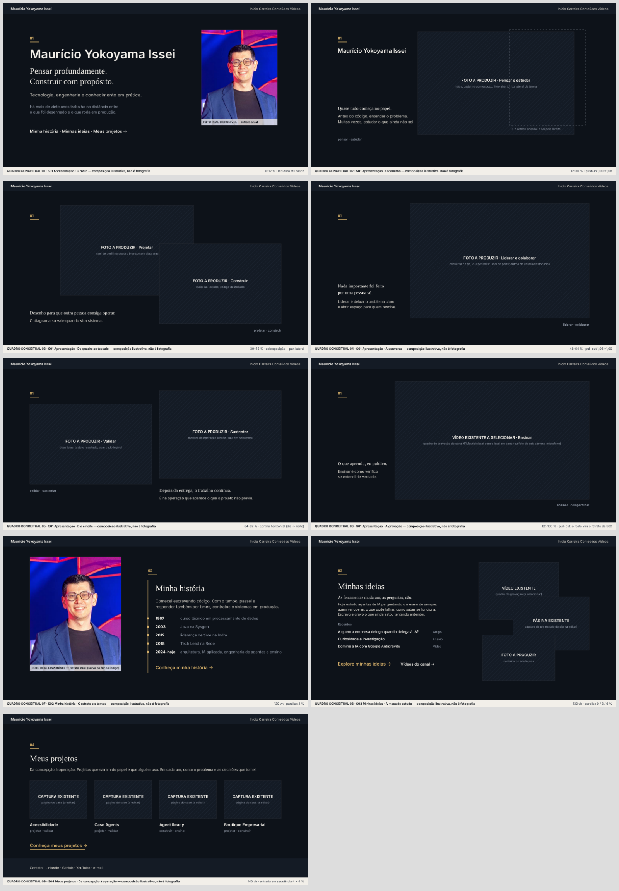
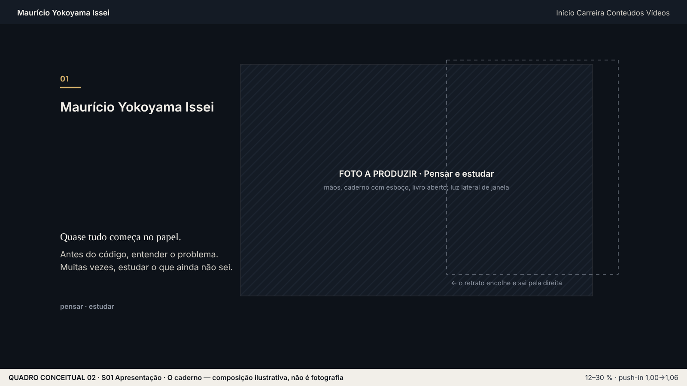
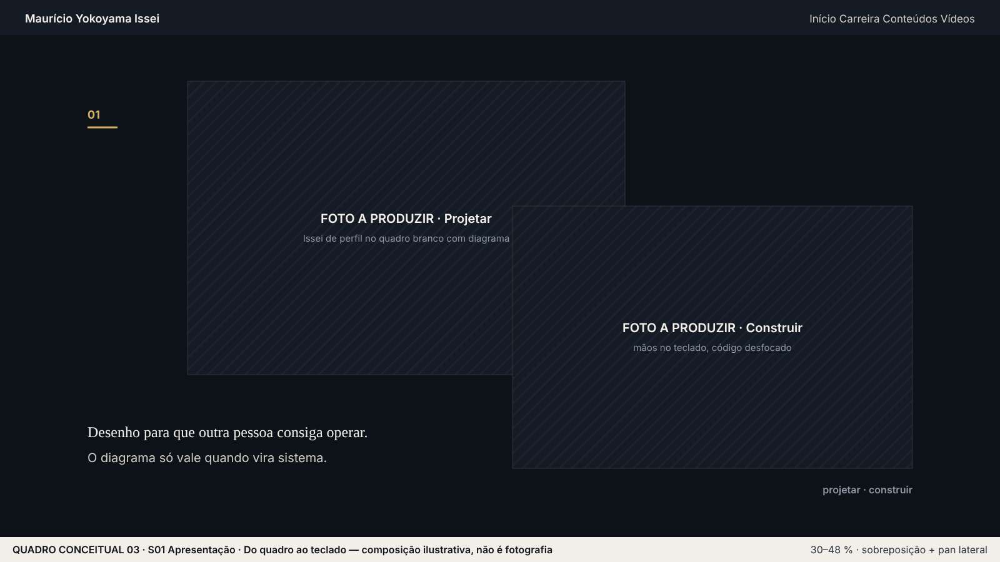
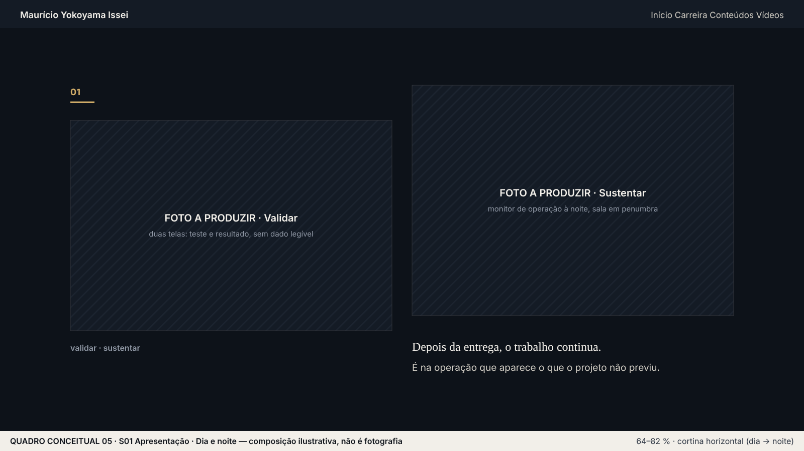

# Storyboard da nova home — "O pensamento em prática"

> Os quadros deste documento são **conceituais**: desenhos de composição com
> caixas hachuradas no lugar das fotos que ainda não existem. A única
> fotografia que aparece é o **retrato real** do Issei, já publicado no site,
> e ela está marcada como tal. Nenhum quadro é fotografia real de uma cena.
> As imagens ficam em `quadros/` (PNG para ver, SVG para editar).
>
> Legenda de origem usada em todo o documento:
> **[D]** disponível · **[E]** existente, precisa ser selecionado ou editado ·
> **[P]** precisa ser produzido · **[C]** referência conceitual, sem recurso ainda.

---

## 1. Conceito e intenção narrativa

**O pensamento em prática.** O filme mostra uma pessoa que pensa antes de
fazer e continua pensando enquanto faz. A câmera não descreve um currículo;
ela acompanha um dia de trabalho que poderia ser qualquer dia dos últimos
vinte anos: o caderno, o quadro, o teclado, a conversa, o teste, a operação, a
gravação.

A intenção é que o visitante saia com três ideias:

1. **Quem:** Maurício Yokoyama Issei, rosto real, primeira imagem.
2. **Como trabalha:** as oito dimensões não são uma lista. Uma leva à outra.
   Pensar leva a estudar; o desenho só vale quando vira sistema; o sistema só
   existe com pessoas; a entrega continua na operação; o que se aprende ali
   vira ensino. E ensinar volta a exigir pensar.
3. **O que encontra aqui:** três caminhos, que são três faces da mesma
   pessoa: a trajetória (Minha história), o que pensa e publica (Minhas
   ideias) e o que construiu (Meus projetos).
4. **Por que isso importa hoje:** quem estuda agentes de IA agora traz vinte
   anos de engenharia, arquitetura e operação. As ferramentas mudaram; as
   perguntas, não. A ponte é dita uma vez, na cena 08.

O filme **começa e termina no rosto**: abre no retrato e fecha a abertura na
gravação do canal, onde ele fala com quem assiste. Isso fecha o ciclo
"pensar → … → ensinar" sem precisar dizer. Da gravação, o rosto passa direto
para o retrato da história (cena 07), sem tela de menu no meio.

**Uma voz só.** Toda a narração, da cena 01 à 09, usa a mesma voz: primeira
pessoa, frase curta, com o atrito real do trabalho. Os textos de apoio das
sessões 02–04 seguem essa voz e não usam palavras de portfólio
("resultados", "soluções", "experiências").

## 2. Sinopse da experiência

A página abre no retrato, com nome, mensagem e os três caminhos já visíveis.
Quem não quiser rolar já sabe quem é e para onde ir.

Ao rolar, o retrato encolhe e sai do quadro, e entra um caderno com esboços:
o pensamento começa no papel. A câmera se afasta do caderno e encontra um
quadro branco com um diagrama; sobre ele desliza a imagem de mãos no teclado:
o desenho vira código. O quadro se abre para uma conversa de pé, com outras
pessoas de costas: nada se faz sozinho. Uma cortina passa do dia para a
noite: de um lado o teste, do outro o monitor de operação. Por fim, a moldura
encontra o Issei gravando um vídeo do canal.

Do rosto na gravação, a moldura recua e volta a ser o retrato, agora ao lado
de cinco marcos da trajetória, de 1997 até hoje (Minha história). O retrato recua e, por trás
dele, deslizam três registros reais de estudo e publicação (Minhas ideias).
Esses registros se alinham e se dividem em quatro capturas de projetos reais
(Meus projetos). O traço dourado que acompanhou toda a página termina como
sublinhado do último link, e o rodapé de contato aparece sem tela de
encerramento.

**Duração:** cerca de 7 telas no computador (690–750 vh, SDD §3.5) e 6 no
celular. Isso dá de 30 a 45 s numa rolagem contínua. Cada cena dura o tempo
de ler uma frase.

## 3. Direção visual e audiovisual

| Aspecto | Direção |
| :-- | :-- |
| Base | Paleta **Aizome + Kin** (SDD §4.1): fundo índigo-carvão `#0D1219`, superfície `#141B25`, penumbra `#080C11` (só cena 05); tinta `#F2EFE9`, texto `#D0CCC3`, legenda `#8F97A4`; ouro fosco *Kintsugi* `#D4AF6A` em **um** elemento por quadro; divisórias de 1 px (*Shoji*). Cabeçalho e rodapé comuns, escuros, como no resto do site |
| Fotografia | Documental, luz natural lateral (janela), sem flash, sem fundo removido, sem filtro. Leve dessaturação (−10 %) na pós, igual em todas. 3:2 nas cenas, 4:5 no retrato |
| Pessoas | O Issei é o único rosto em primeiro plano. Outras pessoas aparecem de costas ou fora de foco, com autorização |
| Lente (equivalente 35 mm) | 35 mm nos planos de ambiente, 50 mm nos médios, 85 mm nos detalhes (mãos, caderno). Sem grande-angular extrema |
| Câmera simulada | Só quatro gestos: *push-in* (aproximar, escala até 1,06), *pull-out*, *pan* lateral (pelo enquadramento da foto) e cortina (revelação por máscara). Nenhuma rotação |
| Tipografia | Nome em Inter 600; mensagem e títulos de sessão em serifada editorial (proposta: Shippori Mincho); texto em Inter 400 |
| Elemento recorrente | **A moldura (M1)**: o retângulo da foto que viaja entre as cenas, com fio *Shoji* e cantos em ouro. **O traço dourado *Kintsugi***: 48 px sob o número da sessão; vira linha vertical na S02 e sublinhado no fim |
| Som | **Nenhum.** A página não toca áudio. A "narração" é texto curto na tela, escrito em primeira pessoa. Se um dia houver versão em vídeo do mesmo roteiro, a narração serve como locução (ver §6) |
| Ritmo | Imagem longa, troca curta: cada foto fica ~12 % da faixa, a troca ocupa ~3 %. Texto parado enquanto a imagem anda |

---

## 4. Storyboard sequencial

> As faixas (%) são da Sessão 01 (referência 300–360 vh, SDD §3.5). As demais sessões são medidas em vh.

### Cena 01 — O rosto

Versão celular: 

| Ficha | |
| :-- | :-- |
| **A. Identificação** | Sessão 01 · Apresentação · Objetivo: responder em 3 s quem é, o que faz e o que há no site |
| **B. Composição** | Retrato 4:5 à direita (colunas 8–11), olhando para a câmera, meio corpo. À esquerda, sobre o fundo índigo: número 01 com traço dourado, nome, mensagem, subtítulo, uma linha de contexto e os três caminhos. 45 % do quadro vazio (Ma). Luz frontal suave. Ponto de atenção: o rosto, depois o nome |
| **C. Direção** | Plano médio. Câmera parada. Sem movimento até a pessoa rolar. Duração: 0–10 % da faixa (~3 s) |
| **D. Texto na tela** | **Maurício Yokoyama Issei** / *Pensar profundamente. Construir com propósito.* / Tecnologia, engenharia e conhecimento em prática. / Há mais de vinte anos trabalho na distância entre o que foi desenhado e o que roda em produção. / Minha história · Minhas ideias · Meus projetos ↓ |
| **D. Relação** | A imagem diz "pessoa real"; a mensagem dá o tom; a linha de contexto nomeia o conflito do trabalho (desenho × produção), que as cenas 02–06 percorrem; os links dizem "o que há aqui". Nada depende de animação |
| **E. Transição** | Começa estática (é a primeira pintura). Ao rolar, o retrato reduz para 60 % e desliza para a direita, saindo do quadro; a moldura M1 fica no lugar e recebe a próxima foto. **Permanece:** M1, o número 01 e o nome (reduzido) |
| **F. Origem** | Retrato **[D]** (`retrato-original.jpg`, blazer azul) **já na H-1**: o fundo azul combina com o índigo da página; a moldura *Shoji* e o espaço vazio fazem a harmonia, sem recorte. Um retrato novo **[P]** é melhoria opcional |

### Cena 02 — O caderno (pensar · estudar)

| Ficha | |
| :-- | :-- |
| **A** | Sessão 01 · Mostrar que o trabalho começa antes do computador |
| **B** | Detalhe de mãos com caneta sobre caderno com esboços (caixas, setas); um livro técnico aberto ao lado; mesa de madeira clara. Luz lateral de janela, sombras suaves. Paleta natural (papel, madeira, tinta azul ou preta). Ponto de atenção: a ponta da caneta |
| **C** | Plano de detalhe, 85 mm, de cima a 45°. *Push-in* lento (1,00 → 1,06). Mãos paradas (foto). 12–30 % (~5 s) |
| **D** | *Quase tudo começa no papel.* Antes do código, entender o problema. Muitas vezes, estudar o que ainda não sei. |
| **D. Relação** | A imagem mostra o gesto; o texto explica a ordem (entender antes de fazer). "Estudar o que ainda não sei" liga pensar e estudar sem lista |
| **E** | Entra por cortina de baixo para cima dentro de M1, enquanto o retrato sai. Termina com o *push-in* parando no esboço de um diagrama. **Permanece:** o esboço de diagrama, que reaparece "passado a limpo" no quadro branco da cena 03 |
| **F** | **[P]** Foto 1 da lista (§7). Rosto fora do quadro ou parcial |

### Cena 03 — Do quadro ao teclado (projetar · construir)

| Ficha | |
| :-- | :-- |
| **A** | Sessão 01 · Mostrar que o desenho existe para virar sistema |
| **B** | Foto A: o Issei de perfil diante de quadro branco com o diagrama (o mesmo tipo de desenho do caderno), marcador na mão. Foto B, sobreposta e deslocada para baixo e à direita: mãos no teclado, tela com código desfocado. Luz de escritório diurna. Ponto de atenção: passa do diagrama (A) para as mãos (B) |
| **C** | A: plano médio, 35 mm. B: detalhe, 50 mm. *Pan* lateral em A (o enquadramento anda da esquerda para a direita pelo diagrama); B entra deslizando por cima. 30–48 % (~5 s) |
| **D** | *Desenho para que outra pessoa consiga operar.* O diagrama só vale quando vira sistema. |
| **D. Relação** | É a cena do "construir com propósito": o propósito é que outra pessoa opere. O texto não descreve a imagem; diz o critério |
| **E** | Começa com o diagrama do caderno "virando" o diagrama do quadro (mesma posição no quadro, troca por dissolve). Evolui com B deslizando sobre A. Termina com B ocupando M1 inteira e o *zoom* recuando (*pull-out*). **Permanece:** M1 e a direção do movimento (esquerda → direita) |
| **F** | **[P]** Fotos 3 e 4 da lista. O conteúdo do quadro deve ser um diagrama genérico desenhado pelo Issei, sem dado de empresa |

### Cena 04 — A conversa (liderar · colaborar)

| Ficha | |
| :-- | :-- |
| **A** | Sessão 01 · Mostrar que o trabalho acontece com outras pessoas |
| **B** | Plano médio de uma conversa de pé, perto de uma mesa ou de um quadro; o Issei de perfil, gesticulando ou ouvindo; duas ou três pessoas de costas ou fora de foco. Luz natural. Ponto de atenção: o Issei **ouvindo** (não discursando) |
| **C** | Plano médio, 35 mm, altura dos olhos. *Pull-out* (1,06 → 1,00), como quem se afasta para ver o grupo. 48–64 % (~5 s) |
| **D** | *Nada importante foi feito por uma pessoa só.* Liderar é deixar o problema claro e abrir espaço para quem resolve. |
| **D. Relação** | A foto mostra escuta; o texto define liderança sem adjetivo. Ancora as recomendações reais do `cv.json` sem citá-las (elas ficam em /curriculo) |
| **E** | Começa com o *pull-out* da cena 03 continuando: o teclado sai de foco e o grupo entra. Termina com a imagem parada e uma cortina horizontal entrando pela direita. **Permanece:** o movimento de afastamento (a câmera "dá um passo para trás") |
| **F** | **[P]** Foto 5. Exige autorização de imagem das outras pessoas, mesmo de costas |

### Cena 05 — Dia e noite (validar · sustentar)

| Ficha | |
| :-- | :-- |
| **A** | Sessão 01 · Mostrar que a entrega não é o fim |
| **B** | Duas fotos lado a lado, assimétricas. Esquerda (dia, menor): duas telas com um teste e o resultado, sem dado legível. Direita (noite, maior, mais alta): monitor com painel de operação numa sala em penumbra, só a luz da tela. A diferença de luz entre as duas conta a passagem do tempo. Ponto de atenção: a luz da tela à noite |
| **C** | Planos médios fechados, 50 mm. Cortina horizontal: a foto da noite entra da direita e empurra a do dia. 64–82 % (~5 s) |
| **D** | *Depois da entrega, o trabalho continua.* É na operação que aparece o que o projeto não previu. |
| **D. Relação** | Liga a experiência real de sustentação (Tech Lead, incidentes, estabilidade: `cv.json`) sem citar números. A noite é a única luz baixa do filme: marca a dimensão "sustentar" |
| **E** | Começa com a cortina vinda da cena 04. Termina com a foto do dia saindo pela esquerda e a da noite crescendo para M1. **Permanece:** a luz de tela, que na cena 06 vira a luz da gravação |
| **F** | **[P]** Fotos 6 e 7. Telas sem nome de empresa, sem dado de cliente |

### Cena 06 — A gravação (ensinar · compartilhar)

| Ficha | |
| :-- | :-- |
| **A** | Sessão 01 · Fechar o ciclo: o que se aprende vira conteúdo; volta o rosto |
| **B** | O Issei gravando um vídeo do canal: plano médio, de frente ou três-quartos, falando; câmera ou microfone visível na borda. Luz suave de rosto. Ponto de atenção: o rosto, pela segunda vez no filme |
| **C** | Plano médio, 50 mm. *Push-in* curto (1,00 → 1,04). 82–100 % (~5 s) |
| **D** | *O que aprendo, eu publico.* Ensinar é como verifico se entendi de verdade. |
| **D. Relação** | A frase liga ensinar a pensar (o começo do filme): o ciclo se fecha sem precisar dizer "ciclo" |
| **E** | Começa com a luz da tela da noite clareando até a luz da gravação (dissolve curto). Termina com *pull-out*: M1 recua e desliza para a esquerda até o lugar do retrato da S02, e a gravação dissolve para o retrato (cena 07). **Permanece:** o rosto, que passa da gravação para o retrato |
| **F** | **[E]** Quadro de um vídeo do canal @MauricioIssei em que o Issei aparece (precisa verificar quais vídeos mostram o rosto) **ou [P]** foto 8 (set de gravação) |

### Cena 07 — O retrato e o tempo (Minha história)

| Ficha | |
| :-- | :-- |
| **A** | Sessão 02 · Dar acesso à trajetória sem repetir o /curriculo |
| **B** | Retrato 4:5 à esquerda (5 colunas). À direita: número 02, o traço dourado agora vertical, título, texto de apoio, cinco marcos de ano no traço e o link. Ponto de atenção: o retrato, depois o link dourado |
| **C** | Plano médio. Parallax: a foto sobe 4 % mais devagar que a rolagem. Os cinco marcos aparecem um a um, de cima para baixo. 120 vh (~6 s) |
| **D** | **Minha história** / Comecei escrevendo código. Com o tempo, passei a responder também por times, contratos e sistemas em produção. / 1997 curso técnico em processamento de dados · 2003 Java na Sysgen · 2012 liderança de time na Indra · 2018 Tech Lead na Rede · 2024–hoje arquitetura, IA aplicada, engenharia de agentes e ensino / **Conheça minha história →** |
| **D. Relação** | Cinco marcos e nenhum resultado detalhado: a história completa (resultados, recomendações, certificações) fica no destino. O último marco é aberto ("hoje") e liga liderança e operação à fase atual, preparando a cena 08. Fontes: `cv.json` (Rede: fev de 2018 – o momento) e o texto do marco 2024–hoje definido pelo Issei |
| **E** | Começa com o rosto da gravação (cena 06) recuando até o lugar do retrato. Termina com o retrato reduzindo para 1/3 e deslizando para a direita, enquanto duas molduras entram por trás. **Permanece:** o traço dourado, que volta a ser horizontal na S03 |
| **F** | Retrato **[D]/[E]** (mesmo da cena 01; se houver um segundo retrato real, em outro ambiente, ele dá variedade **[P]**). Anos **[D]** (`cv.json`; marco 2024–hoje definido pelo Issei) |

### Cena 08 — A mesa de estudo (Minhas ideias)

| Ficha | |
| :-- | :-- |
| **A** | Sessão 03 · Mostrar a produção intelectual real e levar ao catálogo |
| **B** | À esquerda: número 03, título, texto de apoio, três "recentes" (título e formato) e dois links. À direita, três registros sobrepostos como papéis sobre uma mesa: quadro de um vídeo do canal, captura de uma página de estudo do site, foto de caderno de anotações. Ponto de atenção: a sobreposição, depois o link |
| **C** | Plano geral da composição. Parallax diferente em cada registro (0 %, 3 %, 6 %), que se assentam no meio da faixa. 130 vh (~6 s) |
| **D** | **Minhas ideias** / As ferramentas mudaram; as perguntas, não. Hoje estudo agentes de IA perguntando o mesmo de sempre: quem vai operar, o que pode falhar, como saber se funciona. Escrevo e gravo o que ainda estou tentando entender. / Recentes: A quem a empresa delega quando delega à IA? (Artigo) · Curiosidade e investigação (Ensaio) · Domine a IA com Google Antigravity (Vídeo) / **Explore minhas ideias →** · Vídeos do canal → |
| **D. Relação** | É a ponte da página: as três perguntas vêm das cenas 03 (quem vai operar) e 05 (o que pode falhar, como saber se funciona), agora aplicadas à IA. Os registros são reais e reconhecíveis (o visitante vai encontrá-los no destino). Os "recentes" são exemplo: na página, a lista sai do gerador de destaques |
| **E** | Começa com o retrato da S02 recuando e os registros deslizando por trás dele. Termina com os três registros se alinhando numa linha e se dividindo em quatro. **Permanece:** as molduras (agora quatro) |
| **F** | Quadro do canal **[E]**, captura de estudo **[E]** (ex.: "Curiosidade e investigação"), caderno **[P]** (pode ser a mesma sessão de fotos da cena 02) |

### Cena 09 — Da concepção à operação (Meus projetos)

| Ficha | |
| :-- | :-- |
| **A** | Sessão 04 · Mostrar projetos reais e a cadeia pensar → sustentar |
| **B** | Número 04, título, texto de apoio. Quatro capturas 16:10 em linha, cada uma com título do projeto e duas dimensões em que ele mais se apoia. Link sublinhado com o traço dourado. Abaixo, rodapé de contato comum (escuro) em papel escuro. Ponto de atenção: as quatro capturas |
| **C** | Plano geral. As capturas entram em sequência por cortina (4 × 4 % da faixa). 140 vh (~6 s) |
| **D** | **Meus projetos** / Da concepção à operação. Projetos que saíram do papel e que alguém usa. Em cada um, conto o problema e as decisões que tomei. / Acessibilidade · Case Agents · Agent Ready · Boutique Empresarial / **Conheça meus projetos →** |
| **D. Relação** | As dimensões em cada cartão retomam as cenas 02–06: o visitante reconhece no projeto o que viu no filme. As duplas são proposta e precisam da confirmação do Issei |
| **E** | Começa com as quatro molduras vindas da cena 08. Termina com o traço dourado virando o sublinhado do link e o rodapé entrando normalmente (sem tela final). **Permanece:** o traço dourado, do primeiro ao último quadro |
| **F** | Capturas **[E]** das páginas `acessibilidade`, `case-agents`, `agent-ready`, `boutique-empresarial-showcase` (recortar a parte de cima, sem texto pequeno) |

---

## 5. Continuidade e mapa de transições

| De → Para | Gesto | Elemento que permanece |
| :-- | :-- | :-- |
| 01 → 02 | Retrato reduz e sai; cortina de baixo para cima | Moldura M1, nome reduzido |
| 02 → 03 | Esboço do caderno vira diagrama do quadro (dissolve no mesmo lugar) | O desenho do diagrama |
| 03 → 04 | *Pull-out*: teclado sai de foco, grupo entra | Direção do movimento (afastar) |
| 04 → 05 | Cortina horizontal | O corte dia → noite |
| 05 → 06 | Luz da tela clareia até a luz da gravação | A luz de tela |
| 06 → 07 | *Pull-out*: M1 recua até o lugar do retrato; a gravação dissolve para o retrato | O rosto (gravação → retrato) + traço dourado (vira vertical) |
| 07 → 08 | Retrato recua; registros deslizam por trás | Molduras, traço volta a horizontal |
| 08 → 09 | Registros se alinham e se dividem em quatro | Molduras → cartões de projeto |
| 09 → rodapé | Traço vira sublinhado do link | Traço dourado |

**A moldura contínua funciona** e foi mantida: ela é o "olho" do visitante e
nunca some. Ela muda de escala três vezes (retrato → cena inteira → retrato →
quatro), o que dá ritmo sem precisar de efeito novo.

**Gestos usados:** *push-in* (3×), *pull-out* (2×), cortina (3×), dissolve (2×),
divisão de moldura (1×), parallax (2×). Nenhum se repete mais de três vezes.

---

## 6. Narração completa em primeira pessoa

Texto curto na tela (sem áudio). Proposta para o Issei revisar; nenhuma
frase afirma fato que não esteja no `cv.json` ou no site.

> **Abertura.** Há mais de vinte anos trabalho na distância entre o que foi
> desenhado e o que roda em produção.
>
> Quase tudo começa no papel. Antes do código, entender o problema. Muitas
> vezes, estudar o que ainda não sei.
>
> Desenho para que outra pessoa consiga operar. O diagrama só vale quando vira
> sistema.
>
> Nada importante foi feito por uma pessoa só. Liderar é deixar o problema
> claro e abrir espaço para quem resolve.
>
> Depois da entrega, o trabalho continua. É na operação que aparece o que o
> projeto não previu.
>
> O que aprendo, eu publico. Ensinar é como verifico se entendi de verdade.
>
> **Minha história.** Comecei escrevendo código. Com o tempo, passei a
> responder também por times, contratos e sistemas em produção.
>
> **Minhas ideias.** As ferramentas mudaram; as perguntas, não. Hoje estudo
> agentes de IA perguntando o mesmo de sempre: quem vai operar, o que pode
> falhar, como saber se funciona. Escrevo e gravo o que ainda estou tentando
> entender.
>
> **Meus projetos.** Da concepção à operação. Projetos que saíram do papel e
> que alguém usa. Em cada um, conto o problema e as decisões que tomei.

Total: ~180 palavras, todas na mesma voz. Os títulos das sessões 02–04 e a
frase "Da concepção à operação" são os que o Issei definiu; os textos de
apoio foram reescritos na revisão 2 (§9.1).

---

## 7. Inventário de recursos

### 7.1 Por origem

| # | Recurso | Cena | Origem | Ação |
| :-- | :-- | :-- | :-- | :-- |
| R1 | Retrato real (`retrato-original.jpg`) | 01, 07 | **[D]** | Usar como provisório |
| R2 | Retrato 4:5 novo (opcional) | 01, 07 | **[P]** | Melhoria; o R1 já serve no fundo índigo |
| R3 | Mãos, caderno, livro | 02, 08 | **[P]** | Foto 1 + variação "caderno" |
| R4 | Quadro branco com diagrama | 03 | **[P]** | Foto 3 |
| R5 | Mãos no teclado | 03 | **[P]** | Foto 4 |
| R6 | Conversa de pé | 04 | **[P]** | Foto 5 (autorização de imagem) |
| R7 | Telas de teste (dia) | 05 | **[P]** | Foto 6 |
| R8 | Monitor de operação (noite) | 05 | **[P]** | Foto 7 |
| R9 | Gravação do canal | 06, 08 | **[E]** ou **[P]** | Selecionar quadro de vídeo com o rosto, ou foto 8 |
| R10 | Captura de página de estudo | 08 | **[E]** | Capturar e recortar ("Curiosidade e investigação") |
| R11 | Capturas dos 4 cases | 09 | **[E]** | Capturar topo das páginas, 16:10 |
| R12 | Marcos 1997/2003/2012/2018/2024–hoje | 07 | **[D]** | `cv.json` e texto do marco 2024–hoje do Issei |
| R13 | Títulos dos recentes | 08 | **[D]** | Gerador de destaques |
| R14 | Atmosfera e luz das cenas | todas | **[C]** | Só os quadros deste documento |

### 7.2 Lista de fotos para a sessão (uma manhã, luz de janela)

| Foto | Plano | Lente | Indicações |
| :-- | :-- | :-- | :-- |
| 1 Caderno | detalhe, de cima a 45° | 85 mm | Esboço real feito pelo Issei; livro técnico aberto; mesa clara |
| 2 Retrato (opcional) | médio, 4:5 | 85 mm | Fundo escuro ou neutro, que combine com o índigo; olhando para a câmera; mesma roupa sóbria da sessão |
| 3 Quadro branco | médio, de perfil | 35 mm | Diagrama genérico (caixas e setas), sem nome de empresa |
| 4 Teclado | detalhe | 50 mm | Código desfocado; nada legível |
| 5 Conversa | médio | 35 mm | 2–3 pessoas de costas; Issei ouvindo |
| 6 Teste | médio fechado | 50 mm | Duas telas, sem dado legível |
| 7 Operação | médio fechado | 50 mm | À noite, só luz da tela |
| 8 Gravação | médio | 50 mm | Câmera e microfone na borda; Issei falando |

Todas em 3:2 (exceto o retrato), ≥ 2400 px, mesma roupa nas fotos 2, 3, 5 e 8
para dar continuidade de personagem.

---

## 8. Mapa de acesso às páginas existentes

| Onde aparece | Link | Destino existente |
| :-- | :-- | :-- |
| Cena 01 (topo) | Minha história | `#historia` (âncora) → `/curriculo` |
| Cena 01 | Minhas ideias | `#ideias` → `/catalogo` |
| Cena 01 | Meus projetos | `#projetos` → destino de D-H3 (proposta: grupo de projetos no `/catalogo`) |
| Cena 07 | Conheça minha história | `/curriculo` |
| Cena 08 | Explore minhas ideias | `/catalogo` |
| Cena 08 | Vídeos do canal | `/videos` |
| Cena 08 | 3 recentes | páginas de conteúdo (gerador de destaques) |
| Cena 09 | 4 cartões | `/acessibilidade`, `/case-agents`, `/agent-ready`, `/boutique-empresarial-showcase` |
| Cena 09 | Conheça meus projetos | D-H3 |
| Todas | Cabeçalho comum | Início · Carreira · Conteúdos · Vídeos |
| Fim | Rodapé | Contato, LinkedIn, GitHub, YouTube, e-mail |

Qualquer conteúdo fica a **no máximo 2 cliques** da primeira tela, sem rolar.

---

## 9. Avaliação crítica e ajustes

| Critério | Avaliação | Ajuste feito ou recomendado |
| :-- | :-- | :-- |
| Autenticidade | Boa, **se as fotos forem reais e do dia a dia**. O risco é a sessão de fotos parecer encenada | Fotografar trabalho real (o esboço é dele, a conversa é uma reunião de verdade). Recusar fotos "posadas para banco de imagem" |
| Identidade | A assinatura vem da moldura + traço dourado + Ma, não de ornamento oriental | Nada de ícones japoneses, carimbos, ideogramas ou bambu |
| Clareza | A cena 01 responde quem, o quê e onde, sem rolar | Mantida estática; nenhuma informação essencial só na animação |
| Continuidade | O fio é a moldura e o retorno do rosto (01 → 06 → 08) | Ok |
| Proporção | 9 cenas, ~7 telas, 30–45 s | **Ajuste feito:** as oito dimensões foram agrupadas em 5 cenas (pares). Oito cenas de uma dimensão cada viravam uma lista de slogans |
| Relevância | Cena 05 juntava duas ideias diferentes | Mantida: dia/noite dá a única variação de luz do filme e mostra a passagem do tempo da operação |
| Fotografia | Hoje só R1 é real | Sem as fotos, as cenas 02–05 não existem. **Plano B:** lançar só com as cenas 01, 06, 07–09 (retrato, quadros do canal e capturas). O filme fica mais curto e continua coerente |
| Navegação | Caminhos aparecem na cena 01, com CTA em cada sessão | Ok (revisão 2: a repetição na antiga cena 07 saiu) |
| Originalidade | A divisão da moldura (08 → 09) e o rosto que passa da gravação ao retrato (06 → 07) são os gestos próprios da página | Ok |
| Viabilidade | Uma manhã de fotos (8 fotos + retrato) e 5 capturas de tela | Ok; não depende de vídeo nem de IA |

**Cenas eliminadas ou fundidas:**

- "Estudar" separado de "pensar": fundido na cena 02 (a mesma mesa).
- "Validar" separado de "sustentar": fundido na cena 05.
- Uma "tela final" com logo: eliminada (o pedido proíbe interromper; o
  traço vira sublinhado e o rodapé entra).
- "Os três caminhos" (antiga cena 07): eliminada na revisão 2. Criava um falso
  final e repetia o menu da cena 01 antes das sessões que já são esses
  caminhos. A gravação passa direto para o retrato.

### 9.1 Revisão 2 (comentários do Issei, 2026-11-24)

| # | Ponto | Ajuste |
| :-- | :-- | :-- |
| 1 | Duas vozes: autoral nas cenas 02–06, institucional nas sessões 02–04, com "resultados" repetido | Textos de apoio das cenas 07, 08 e 09 reescritos em primeira pessoa, com atrito real; "resultados", "soluções" e "experiências" saíram da narração |
| 2 | A antiga cena 07 criava um falso final e repetia os três caminhos | Cena eliminada. Transição 06 → 07 direta (gravação → retrato). As cenas foram renumeradas: 9 cenas em 4 sessões |
| 3 | Linha do tempo parava em 2018 | Quinto marco aberto: "2024–hoje arquitetura, IA aplicada, engenharia de agentes e ensino" (texto do Issei, revisão 3; substitui a proposta "2025" da revisão 2) |
| 4 | Faltava a ponte entre engenharia clássica e IA | Frase na cena 08: "As ferramentas mudaram; as perguntas, não." seguida das três perguntas que as cenas 03 e 05 já mostraram |
| 5 | Linha de contexto da cena 01 descrevia o site | Nova linha: "Há mais de vinte anos trabalho na distância entre o que foi desenhado e o que roda em produção." Nomeia o conflito que as cenas 02–06 percorrem |

### 9.2 Revisão 3 (validação do protótipo, Issei, 2026-11-24)

- Direção visual consolidada: **Aizome + Kin** (escura editorial oriental). A
  base clara e a exceção de tema saíram (SDD D-H1, D-H5).
- O traço vermelho virou **traço dourado *Kintsugi*** (`--hm-kin`), único
  acento da página; divisórias de 1 px (*Shoji*).
- O retrato atual entra já na H-1; a sessão de fotos enriquece as cenas 02–05
  depois, sem bloquear.
- Marco final da cena 07: "2024–hoje".

**Pontos para o Issei confirmar:**

1. A nova linha de contexto da cena 01 (o "mais de vinte anos" vem do `cv.json`).
2. As duplas de dimensões nos quatro projetos (cena 09).
3. Quais vídeos do canal mostram o seu rosto (para R9).
4. As frases da narração, uma a uma: são propostas, não citações suas.

---

## 10. Proposta consolidada

Um filme de **9 cenas em 4 sessões**, sem som, conduzido pela rolagem:

1. **O rosto** — quem, o quê e os três caminhos, já no primeiro quadro.
2. **O caderno** — pensar e estudar.
3. **Do quadro ao teclado** — projetar e construir.
4. **A conversa** — liderar e colaborar.
5. **Dia e noite** — validar e sustentar.
6. **A gravação** — ensinar; o rosto volta.
7. **O retrato e o tempo** — Minha história, de 1997 até hoje → `/curriculo`.
8. **A mesa de estudo** — Minhas ideias; a ponte para a IA → `/catalogo`, `/videos`.
9. **Da concepção à operação** — Meus projetos → 4 cases.

Os elementos que dão a assinatura são **a moldura que viaja e se divide**,
**o traço dourado do primeiro ao último quadro** e **o rosto que abre e
fecha a abertura**. Tudo o mais é fotografia real e espaço vazio.

Para produzir: uma manhã de fotos (§7.2), cinco capturas de tela e a
seleção de um quadro do canal. Nenhum recurso de IA, nenhum vídeo novo
obrigatório.
